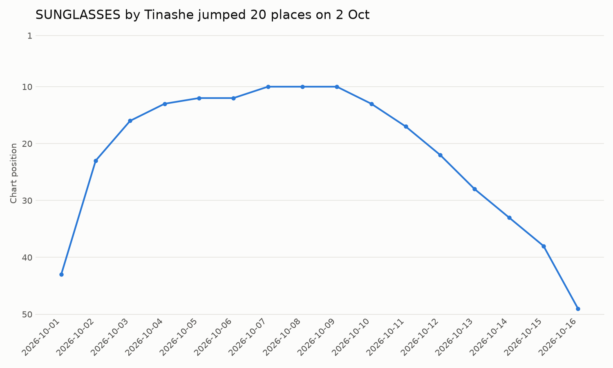
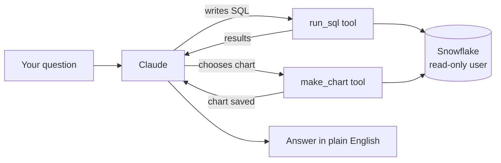

# Last.fm Music Agent

An AI agent that answers questions about the Last.fm global Top 50 in plain English. It writes its own SQL, runs it on Snowflake, answers in text or with a chart, and remembers the conversation for follow-up questions.

It runs on top of my own data pipeline, [lastfm-pipeline](https://github.com/Boiler82/lastfm-pipeline), which loads the chart into Snowflake every day:

```
Last.fm API → Python → Snowflake → dbt → Data Studio dashboard
                           ↓
                   Last.fm Music Agent (this project)
```

Built with Python, the Claude API and Snowflake.



---

## What it does

A real conversation (SQL shortened):

```
You: Which track climbed the most positions in a single day? Show its chart position over time.
  [step 1] run_sql: with snaps as (select distinct DATE(LOADED_AT) d ...), prev as (... lag(d) over (order by d) ...) ...
  [step 2] make_chart: select DATE(LOADED_AT)::string as day, CHART_POSITION ... where TRACK_NAME = 'SUNGLASSES' ...

Agent: "SUNGLASSES" by Tinashe had the biggest one-day climb. It rose 20 places, from #43 on
2026-10-01 to #23 on 2026-10-02.

I compared each track with the previous day's snapshot. Tracks that weren't on the chart the day
before count as new entries, so I left them out. The data covers 2026-10-01 to 2026-10-22.

The next biggest climbs were also Tinashe tracks from the same day: "Too Easy" (+18) and
"Crash Out" (+15). [...]

You: Which track has spent the most days at #1?
  [step 1] run_sql: select TRACK_NAME, ARTIST_NAME, count(distinct DATE(LOADED_AT)) days_at_1 ...

Agent: "NICOLE KIDMAN" by ADÉLA has spent the most days at #1. It was #1 on all 24 daily
snapshots, from 2026-09-28 to 2026-10-21. No other track reached #1 in that period.

I need to correct my last answer. I said the data ran to 2026-10-22, but it actually covers
2026-09-28 to 2026-10-21. The 10-22 date was only in the chart's filename. The "SUNGLASSES"
result isn't affected, because the biggest climb happened on 2026-10-02.
```

The agent decides which queries to run, compares each day with the previous day's chart, draws the chart, and explains its method. Because it remembers the conversation, it noticed that it had stated the wrong date range in its first answer and corrected itself in the second.

Three Tinashe tracks jumping on the same day is a pattern the data alone can't explain. It often points to an album release, which an outside source would have to confirm.

## How it works



| Tool | What it does |
|---|---|
| `run_sql` | Runs one SELECT query on Snowflake and returns up to 50 rows |
| `make_chart` | Runs a query and draws a bar, horizontal bar or line chart. Chart positions are drawn with #1 at the top |

## Safety: least privilege

- The agent logs in as a **dedicated read-only Snowflake user** (`LASTFM_REPORTING_USER`) with key-pair authentication. Its role can only read, so Snowflake itself blocks any change to the data, whatever SQL the agent writes.
- On top of that, the code refuses anything that is not a single `SELECT` or `WITH … SELECT` query.
- Queries stop after 30 seconds, and the agent loop stops after 10 steps.
- Secrets live in a `.env` file and the private key outside the project; both are excluded from Git.

## The data

The global Top 50 is saved once a day. At the time of the evaluation the data held **24 daily snapshots** (28 September – 21 October 2026): 1,200 rows, 81 tracks and 35 artists.

The agent is given a few notes about the data, written from my own exploration of it:
- A track is identified by **track name and artist together**.
- **A lower position is better**: a drop means the number gets bigger.
- To compare a track with "the day before", use the **previous day's chart**, not the track's previous appearance. Otherwise a track that leaves the chart and comes back looks like a big climb instead of a re-entry.

## Evaluation

I wrote 14 test questions, each with an answer key: my own SQL query that calculates the correct answer. Because the chart grows every day, **the correct answers are calculated live** each time the test runs, so the test never goes out of date. A script (`evaluate.py`) asks the agent every question and grades the answers automatically.

| Level | Questions | Examples |
|---|---|---|
| Easy | 5 | Number of snapshots, artists and tracks; today's #1 |
| Medium | 4 | Artist with the most tracks; tracks present every day; second-best average position (lower is better) |
| Hard | 3 | Biggest one-day climb and drop; new entries in today's chart |
| Tricky | 2 | Number of re-entries; one artist's share of the chart |

### Results

| Run | Model | Change | Score | What went wrong |
|---|---|---|---|---|
| 1 | Claude Sonnet | first version | **14/14** | – |
| 2 | Claude Haiku | first version | 13/14 | Used a ready-made "chart drops" table that only covers the last 3 days, and reported 12 instead of 40 |
| 3 | Claude Haiku | removed that table from the agent | 13/14 | Calculated a climb instead of a drop (`previous − current` instead of `current − previous`) |
| 4 | Claude Haiku | explained climb vs drop in the notes | **14/14** | – |
| 5 | Claude Sonnet | regression test after the changes | **14/14** | – |
| 6 | Claude Haiku | repeat run | **14/14** | – |

### What I learned

**1. Fewer tools can make an agent more accurate.** My pipeline also has a mart table of recent chart drops. It is correct for its own purpose, but for "the biggest drop ever" it gives a wrong answer. The data note warned against it and Sonnet followed the note, but Haiku took the shortcut anyway. Removing the table from what the agent can see fixed it more reliably than a stronger warning would have.

**2. Small models need precise definitions.** "Lower is better" was in the notes, yet Haiku still subtracted in the wrong direction. Spelling out the formula for a drop and a climb, with an example, fixed it.

**3. Check the method, not only the score.** In the final runs, Haiku still answered the climb and drop questions by comparing each track with its previous *appearance* rather than the previous *day*. With today's data that gives the right numbers, but it could break once a re-entry produces a bigger "climb". The test grades answers, not methods, so reading the agent's SQL still matters. A next step is test questions designed so that only the correct method gives the right answer.

## Run it yourself

1. You need a Snowflake account with the Last.fm tables from [lastfm-pipeline](https://github.com/Boiler82/lastfm-pipeline), a read-only user with key-pair authentication, and an Anthropic API key.
2. Set up the project:
   ```bash
   python3 -m venv .venv
   source .venv/bin/activate
   pip install -r requirements.txt
   cp .env.example .env      # then fill in your own values
   ```
3. Check the connection, then ask questions:
   ```bash
   python test_connection.py
   python agent.py
   ```
4. Run the evaluation:
   ```bash
   python evaluate.py                                          # default model (Sonnet)
   AGENT_MODEL=claude-haiku-4-5-20251001 python evaluate.py    # another model
   ```

## Project structure

```
├── agent.py             # the agent: Snowflake connection, tools, data notes and the agent loop
├── eval_questions.py    # 14 test questions with live SQL answer keys
├── evaluate.py          # asks the agent every question and grades the answers
├── test_connection.py   # checks the Snowflake login and the role's privileges
├── eval_results_*.csv   # saved results of each evaluation run
├── charts/              # charts made by the agent
└── images/              # charts used in this README
```

## Next steps

- Test questions where only the correct method gives the right answer (see lesson 3)
- A web search tool, to explain chart movements with outside information, such as an album release
- A simple web interface with Streamlit

---

**Fabio Boila**, data analyst student at Hyper Island, Stockholm · Related: [lastfm-pipeline](https://github.com/Boiler82/lastfm-pipeline) · [data-analyst-agent](https://github.com/Boiler82/data-analyst-agent)
